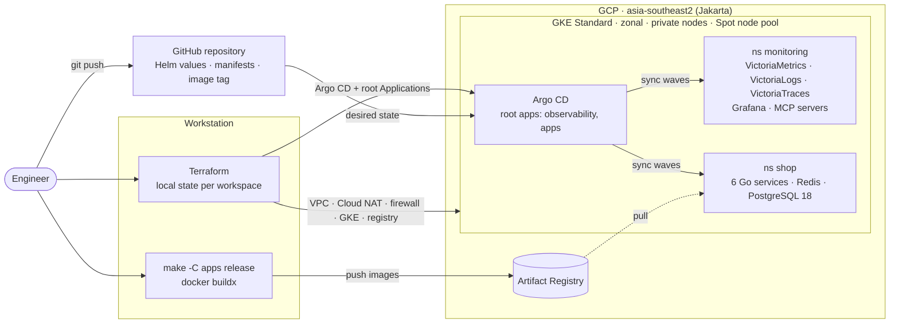
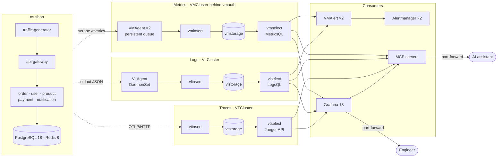

# k8s-victoria-observability

Production-grade observability for Go microservices on GKE — **metrics, logs and traces** with
VictoriaMetrics, VictoriaLogs, VictoriaTraces and Grafana. Everything inside the cluster is deployed
with **GitOps (Argo CD)** on infrastructure provisioned by **Terraform**.

```text
k8s-victoria-observability/
├── observability/   # VictoriaMetrics / VictoriaLogs / VictoriaTraces + Grafana (Argo CD app-of-apps, Helm values)
├── apps/            # 6 Go microservices + Redis + PostgreSQL 18 (source, Dockerfile, Helm chart, data tier)
└── terraform/       # VPC, Cloud NAT, firewall, GKE (Spot), Artifact Registry, Argo CD bootstrap
```

Details: [`observability/`](observability/README.md) · [`apps/`](apps/README.md) · [`terraform/`](terraform/README.md)

## Architecture

### Delivery: Terraform + GitOps

Terraform builds the platform once; after that, Git is the only way to change what runs in the
cluster.



### Runtime: telemetry pipeline

Metrics, logs and traces each run in cluster mode (insert / select / storage) with two replicas
per tier.



| Signal | Collection | Storage | Query | Retention |
|---|---|---|---|---|
| Metrics | VMAgent scrapes every target declared with VMServiceScrape / VMPodScrape and remote-writes through vmauth | VMCluster | MetricsQL (PromQL-compatible) | 14d |
| Logs | VLAgent tails container stdout on every node and parses JSON fields, including `trace_id` | VLCluster | LogsQL | 7d, 8GiB per node |
| Traces | OpenTelemetry SDK sends spans over OTLP/HTTP straight to vtinsert | VTCluster | Jaeger API | 7d, 8GiB per node |
| Alerts | VMAlert evaluates MetricsQL and LogsQL rules; Alertmanager runs as a gossip cluster | – | – | – |

Nothing is exposed publicly: Grafana, Argo CD and the MCP servers are reached with
`kubectl port-forward` through the IAM-gated GKE DNS endpoint.

## Stack

| Area | Choice | Why |
|---|---|---|
| Deployment model | `victoria-metrics-k8s-stack` Helm chart rendering **VictoriaMetrics Operator** CRs; operator installed as a separate app | Official production pattern; the operator handles ordered storage rollouts, config reloads and self-service scrape/rule CRDs |
| Topology | **Cluster mode** for VMCluster, VLCluster and VTCluster (insert/select/storage ×2 on different nodes, PDBs) | Each tier scales out independently; durability comes from GCE persistent disks (no application-level replication); vmauth load-balances vminsert/vmselect |
| Log collection | VLAgent `k8sCollector` DaemonSet | Native VictoriaLogs agent, automatic JSON parsing, checkpoints |
| Trace ingestion | OpenTelemetry SDK → `vtinsert` (OTLP/HTTP) | No extra hop; the SDK batches and retries |
| Grafana datasources | Prometheus + `victoriametrics-metrics-datasource`, `victoriametrics-logs-datasource`, built-in **Jaeger** for traces | Jaeger API is the documented VictoriaTraces integration |
| GitOps | Argo CD app-of-apps with sync waves and an Application health check | Operators and CRDs become healthy before the resources that depend on them |
| Secrets | External Secrets password generator + CloudNativePG-generated credentials | No secret values in Git |
| PostgreSQL 18 | CloudNativePG (`18.6-standard-trixie`) | Production-grade operator with a built-in metrics exporter |
| Cluster | Zonal GKE Standard, private nodes, Dataplane V2, Workload Identity, Spot nodes | Low cost; Cloud Logging/Managed Prometheus disabled for workloads (no double ingest) |
| AI assistants | Read-only MCP servers for metrics, logs, traces, Grafana and PostgreSQL | Ask questions in natural language from any MCP client (Cursor, VS Code, …) ([details](observability/README.md#ai-assistants-mcp)) |

## Correlating signals in Grafana

- **Trace → logs:** "Logs for this span" runs `trace_id:="<id>"` against VictoriaLogs.
- **Log → trace:** the `trace_id` field of every application log links to the trace (derived field).
- **Trace → metrics:** RED metrics of the span's service (`service.name` ↔ `job`).
- **Dashboards (folder "Shop"), from symptom to cause:**
  - *SLO Overview:* user-journey SLOs (checkout, browse) measured at the edge, then per-service SLOs:
    error budget, burn rates, time until the budget is gone and how much data the window holds.
  - *Service:* one service end to end (SLO, RED and latency SLI by route, latency heatmap, dependencies,
    database: connection pool, sessions and PostgreSQL errors of that service, saturation, WARN/ERROR logs,
    slowest and failed traces).
  - Every Shop dashboard marks rollouts and firing critical Shop alerts on its graphs.
  - *Logs:* log volume, top messages and top pods, filterable by service, level and any field.
  - *Microservices Overview:* RED for all services side by side, plus business metrics.
  - *CloudNativePG:* PostgreSQL health, replication, WAL and backups, plus slow statements and errors by
    SQLSTATE from the PostgreSQL logs, lock waits with the sessions holding the locks, top statements and
    table health.
- **Alerting:** SLO burn-rate alerts (multi-window, multi-burn-rate), a payment decline rule and
  **log-based** rules (LogsQL), all evaluated by vmalert. Data-tier alerts link to their runbook
  ([docs/runbooks](docs/runbooks/README.md)), which also describes how to investigate across metrics, logs and
  traces.

## Getting started

Prerequisites: `gcloud`, Terraform 1.15.x (`tfenv`), `kubectl`, Docker with `buildx`, `make`, and a
fork/clone of this repository pushed to GitHub.

```bash
# 0. Local configuration (git-ignored)
cp .env.example .env                       # set PROJECT_ID=<your GCP project>
gcloud config set project <PROJECT_ID>
gcloud auth application-default login

# 1. Infrastructure + GitOps bootstrap (repo URL is read from `git remote origin`)
#    Private repo: export TF_VAR_gitops_repo_password=<read-only GitHub token>
make -C terraform init
make -C terraform apply-all

# 2. Cluster credentials (DNS endpoint, IAM-gated — no bastion/VPN needed)
gcloud container clusters get-credentials staging-observability \
  --location asia-southeast2-a --project "$(gcloud config get-value project)" --dns-endpoint

# 3. Build and push the application images, then commit the new tag (Argo CD rolls it out)
make -C apps auth
make -C apps release
git add apps/k8s/services/values.yaml && git commit -m "release shop" && git push

# 4. Watch the rollout
kubectl -n argocd get applications
```

Sync order (enforced by sync waves):

```text
observability:  external-secrets (-3) → vm-operator (-2) → observability-config (-1) → vm-stack (0) → MCP servers (1)
apps:           cloudnative-pg (-2)   → shop-data (-1)   → shop-services (0)
```

## Accessing the UIs

No load balancers or public endpoints are created; use port-forwarding.

```bash
# Grafana → http://localhost:3000 (user: admin)
kubectl -n monitoring port-forward svc/grafana 3000:80
kubectl -n monitoring get secret grafana-admin -o jsonpath='{.data.admin-password}' | base64 -d; echo

# Argo CD → http://localhost:8080 (user: admin)
kubectl -n argocd port-forward svc/argocd-server 8080:80
kubectl -n argocd get secret argocd-initial-admin-secret -o jsonpath='{.data.password}' | base64 -d; echo
```

## Teardown

```bash
make -C terraform teardown
```

The script deletes the Argo CD applications in reverse sync-wave order, waits until every PVC is
gone (so no orphaned persistent disks keep billing), then destroys the Terraform workspaces.

## Staging defaults vs. production

This setup runs as a low-cost staging environment; the observability configuration itself follows
production practices. To harden it for production:

| Staging default | Production |
|---|---|
| Metrics, logs and traces sharded across storage nodes without replication (durability from persistent disks) | Add storage nodes for capacity; `replicationFactor: 2` with at least 3 vmstorage nodes, or `VMDistributed`/`VLDistributed` (independent clusters) for full data HA |
| All nodes are Spot VMs | Add a small on-demand node pool for stateful workloads (vm/vl/vtstorage, PostgreSQL) |
| Zonal cluster | `regional_cluster = true` |
| 100% trace sampling | Lower `otel.samplerArg` in `apps/k8s/services/values.yaml` (e.g. `0.1`) or add tail sampling with an OpenTelemetry Collector |
| VictoriaMetrics Operator admission webhook disabled | Install cert-manager and set `admissionWebhooks.certManager.enabled: true` |
| Alertmanager `blackhole` receiver | Configure Slack/PagerDuty receivers with credentials from an ExternalSecret |
| PostgreSQL primary + 1 synchronous standby; daily base backups and WAL archiving to a GCS bucket (7-day point-in-time recovery) that is destroyed with the environment | `instances: 3` across zones; backups in a separate project with longer retention and soft delete |
| Single Grafana replica with SQLite on a PVC | External PostgreSQL database for Grafana and 2+ replicas |

## Secrets and configuration

- No secrets, project IDs or repository URLs are committed. `PROJECT_ID` lives in a git-ignored
  `.env`; the image registry (which contains the project ID) is computed by Terraform and injected
  into Argo CD, so Git only stores the image tag.
- Terraform state is local per workspace and git-ignored.
- `make check-project` refuses to plan, apply or tear down when the active `gcloud` project differs
  from `PROJECT_ID`.

## License

[MIT](LICENSE)
