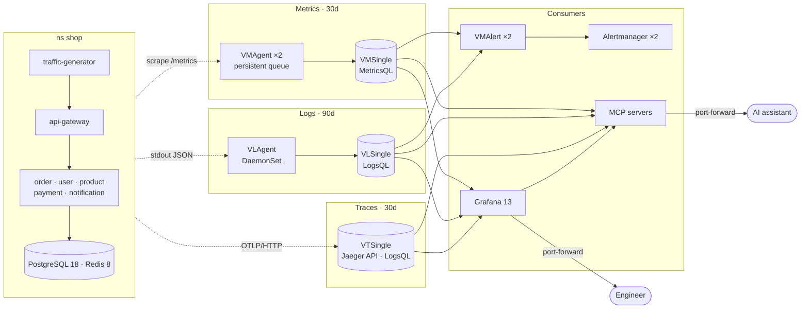

# k8s-victoria-observability

Production-grade observability for Go microservices on GKE — **metrics, logs and traces** with
VictoriaMetrics, VictoriaLogs, VictoriaTraces and Grafana. Everything inside the cluster is deployed
with **GitOps (Argo CD)** on infrastructure provisioned by **Terraform**.

```text
k8s-victoria-observability/
├── observability/   # VictoriaMetrics / VictoriaLogs / VictoriaTraces + Grafana (Argo CD app-of-apps, Helm values)
├── apps/            # 6 Go microservices + Redis + PostgreSQL 18 (source, Dockerfile, Helm chart, data tier)
└── terraform/       # VPC, Cloud NAT, firewall, GKE (Spot), Artifact Registry, Argo CD bootstrap
```

Details: [`observability/`](observability/README.md) · [`apps/`](apps/README.md) · [`terraform/`](terraform/README.md)

## Architecture

### Delivery: Terraform + GitOps

Terraform builds the platform once; after that, Git is the only way to change what runs in the
cluster.


### Runtime: telemetry pipeline

Metrics, logs and traces each run as one single-node process (VMSingle, VLSingle, VTSingle) on a
persistent disk: one component to run per signal, and far more headroom than this workload needs (single-node
VictoriaMetrics serves 100k+ active series and tens of thousands of samples/s; VictoriaLogs compresses logs
~10-50x, so even 2 TB of raw logs a month fits one node). Collection stays highly available: two vmagents with
persistent queues and a vlagent per node buffer while a storage pod restarts.



| Signal | Collection | Storage | Query | Retention |
|---|---|---|---|---|
| Metrics | VMAgent scrapes every target declared with VMServiceScrape / VMPodScrape and remote-writes to VMSingle | VMSingle, 30Gi | MetricsQL (PromQL-compatible) | 30d |
| Logs | VLAgent tails container stdout on every node and parses JSON fields, including `trace_id` | VLSingle, 20Gi | LogsQL | 90d (oldest days dropped once the disk is 80% full) |
| Traces | OpenTelemetry SDK sends spans over OTLP/HTTP straight to VTSingle | VTSingle, 20Gi | Jaeger API, LogsQL | 30d (same 80% guard) |
| Kubernetes events | An OpenTelemetry Collector (`k8s_events` receiver) watches the API server and sends them to VLSingle | VLSingle | LogsQL | 90d (the API server keeps 1h) |
| Alerts | VMAlert evaluates MetricsQL and LogsQL rules; Alertmanager runs as a gossip cluster | – | – | – |

Nothing is exposed publicly: Grafana, Argo CD and the MCP servers are reached with
`kubectl port-forward` through the IAM-gated GKE DNS endpoint.

## Stack

| Area | Choice | Why |
|---|---|---|
| Deployment model | `victoria-metrics-k8s-stack` Helm chart rendering **VictoriaMetrics Operator** CRs; operator installed as a separate app | Official production pattern; the operator handles ordered storage rollouts, config reloads and self-service scrape/rule CRDs |
| Topology | **Single-node** VMSingle, VLSingle and VTSingle on pd-balanced disks; vmagent ×2, vmalert ×2 and Alertmanager ×2 stay replicated | Simplest to run and enough for TBs a month; durability from GCE persistent disks; collection buffers through a storage restart. Disks start small and grow online |
| Log collection | VLAgent `k8sCollector` DaemonSet | Native VictoriaLogs agent, automatic JSON parsing, checkpoints |
| Trace ingestion | OpenTelemetry SDK → VTSingle (OTLP/HTTP) | No extra hop; the SDK batches and retries |
| Kubernetes events | OpenTelemetry Collector (`k8s_events` receiver, one replica) → VictoriaLogs (OTLP) | vlagent reads container logs only; one small pod keeps every event (scheduling, probes, OOM kills, node restarts) for 90 days |
| Grafana datasources | Prometheus + `victoriametrics-metrics-datasource`, `victoriametrics-logs-datasource`, built-in **Jaeger** for traces | Jaeger API is the documented VictoriaTraces integration |
| GitOps | Argo CD app-of-apps with sync waves and an Application health check | Operators and CRDs become healthy before the resources that depend on them |
| Secrets | External Secrets password generator + CloudNativePG-generated credentials | No secret values in Git |
| PostgreSQL 18 | CloudNativePG (`18.6-standard-trixie`) | Production-grade operator with a built-in metrics exporter |
| Cluster | Zonal GKE Standard, private nodes, Dataplane V2, Workload Identity, Spot nodes | Low cost; Cloud Logging/Managed Prometheus disabled for workloads (no double ingest) |
| AI assistants | Read-only MCP servers for metrics, logs, traces, Grafana and PostgreSQL | Ask questions in natural language from any MCP client (Cursor, VS Code, …) ([details](observability/README.md#ai-assistants-mcp)) |

## Correlating signals in Grafana

- **Trace → logs:** "Logs for this span" runs `trace_id:="<id>"` against VictoriaLogs.
- **Log → trace:** the `trace_id` field of every application log links to the trace (derived field).
- **Trace → metrics:** RED metrics of the span's service (`service.name` ↔ `job`).
- **Dashboards (folder "Shop"), from symptom to cause:**
  - *SLO Overview:* user-journey SLOs (checkout, browse) measured at the edge, then per-service SLOs:
    error budget, burn rates, time until the budget is gone and how much data the window holds.
  - *Service:* one service end to end (SLO, RED and latency SLI by route, latency heatmap, dependencies,
    database: connection pool, sessions and PostgreSQL errors of that service, saturation, WARN/ERROR logs,
    slowest and failed traces).
  - Every Shop dashboard marks rollouts, firing critical Shop alerts, node restarts (spot preemptions) and
    shop container restarts with their reason (e.g. OOMKilled) on its graphs.
  - *Logs:* errors and error ratio per service over time, message patterns with their cause, what the
    failing lines have in common (field facets: product, user, pod, node, version), lines by pod and
    version, every line of one request across services, a message search, lines outside the JSON logger
    and the health of the log pipeline (last line per service, dropped lines, collector backlog).
  - *Traces:* distributed tracing analytics computed from the spans (LogsQL on VictoriaTraces): every
    endpoint's latency and failures, where the time goes inside one endpoint's requests (each downstream
    call, SQL statement and Redis command with its share), failures by message, hot spots by product, user,
    pod, node or version, the service map, and the slowest or failed requests opening their trace.
  - *Microservices Overview:* RED for all services side by side, plus business metrics.
  - *Redis:* Redis with Sentinel: who is master and whether a failover could happen right now (quorum,
    healthy sentinels, replicas in sync), the failover timeline from the Sentinel logs, replication, memory
    against maxmemory and the container limit, evictions, server and client latency per command, the
    services' connection pools, the notification stream and its consumers, persistence, and the logs.
  - *CloudNativePG:* PostgreSQL health, replication, WAL and backups, plus slow statements and errors by
    SQLSTATE from the PostgreSQL logs, lock waits with the sessions holding the locks, top statements and
    table health.
- **Cluster — Events (folder "Platform"):** Kubernetes events of every namespace: warnings by reason and
  namespace, node restarts and spot preemptions, why pods fail (scheduling, probes, OOM kills, image pulls) with
  container restarts and their last termination reason, pending pods and the event pipeline.
- **Platform — GitOps & Secrets (folder "Platform"):** Argo CD applications with their sync and health status
  over time, syncs and failed syncs, reconciliation, Git and repo-server; ExternalSecrets, secret stores and
  the External Secrets webhook; cert-manager certificates (renewal, expiry, time left) and issuers; the
  components' resources and error logs. Every sync is an annotation.
- **Observability — Pipeline health (folder "Platform"):** the stack watching itself on one page: scrape targets,
  ingestion of metrics, logs and spans, delivery backlog and retries, every place data is dropped (by cause),
  configured against actual retention and days until each store's disk limit, rule evaluation errors,
  notification failures, kube-dns, and the stack's restarts and memory, each section linking to the component's
  dashboard.
- **Alerting:** SLO burn-rate alerts (multi-window, multi-burn-rate), a payment decline rule,
  **log-based** rules (LogsQL, including Kubernetes events: unschedulable pods, OOM kills, failing image
  pulls), Redis and Sentinel rules (failovers, lost quorum, TILT, replication, evictions, OOM, stuck
  notifications, client pool timeouts) and platform rules (Argo CD sync failures, drift and unhealthy applications, ExternalSecrets that stop
  syncing, certificate renewals and expiry) and pipeline rules (log or span ingestion stopped, retention cut by
  the disk limit), all evaluated by vmalert. Data-tier, Kubernetes and platform alerts
  link to their runbook
  ([docs/runbooks](docs/runbooks/README.md)), which also describes how to investigate across metrics, logs and
  traces.

## Getting started

Prerequisites: `gcloud`, Terraform 1.15.x (`tfenv`), `kubectl`, Docker with `buildx`, `make`, and a
fork/clone of this repository pushed to GitHub.

```bash
# 0. Local configuration (git-ignored)
cp .env.example .env                       # set PROJECT_ID=<your GCP project>
gcloud config set project <PROJECT_ID>
gcloud auth application-default login

# 1. Infrastructure + GitOps bootstrap (repo URL is read from `git remote origin`)
#    Private repo: export TF_VAR_gitops_repo_password=<read-only GitHub token>
make -C terraform init
make -C terraform apply-all

# 2. Cluster credentials (DNS endpoint, IAM-gated — no bastion/VPN needed)
gcloud container clusters get-credentials staging-observability \
  --location asia-southeast2-a --project "$(gcloud config get-value project)" --dns-endpoint

# 3. Build and push the application images, then commit the new tag (Argo CD rolls it out)
make -C apps auth
make -C apps release
git add apps/k8s/services/values.yaml && git commit -m "release shop" && git push

# 4. Watch the rollout
kubectl -n argocd get applications
```

Sync order (enforced by sync waves):

```text
observability:  external-secrets (-3) → vm-operator (-2) → observability-config (-1) → vm-stack (0)
                → MCP servers, k8s-events, platform-monitoring (1)
apps:           cloudnative-pg (-2)   → shop-data (-1)   → shop-services (0)
```

## Accessing the UIs

No load balancers or public endpoints are created; use port-forwarding.

```bash
# Grafana → http://localhost:3000 (user: admin)
kubectl -n monitoring port-forward svc/grafana 3000:80
kubectl -n monitoring get secret grafana-admin -o jsonpath='{.data.admin-password}' | base64 -d; echo

# Argo CD → http://localhost:8080 (user: admin)
kubectl -n argocd port-forward svc/argocd-server 8080:80
kubectl -n argocd get secret argocd-initial-admin-secret -o jsonpath='{.data.password}' | base64 -d; echo
```

## Teardown

```bash
make -C terraform teardown
```

The script deletes the Argo CD applications in reverse sync-wave order, waits until every PVC is
gone (so no orphaned persistent disks keep billing), then destroys the Terraform workspaces.

## Staging defaults vs. production

This setup runs as a low-cost staging environment; the observability configuration itself follows
production practices. To harden it for production:

| Staging default | Production |
|---|---|
| One VMSingle, VLSingle and VTSingle: no query or ingestion HA (a Spot preemption means ~2 minutes without queries and alert evaluation; vmagent and vlagent buffer, spans beyond the SDK queue are lost) | Grow the disks first (`storage`; the 80% limit follows); for HA run two independent copies (`VMDistributed`/`VLDistributed`) or move to cluster mode when one node runs out of CPU or memory |
| Small disks: VMSingle 30Gi, VLSingle and VTSingle 20Gi (oldest log and trace days dropped once a disk is 80% full) | Size for the retention (metrics: retention + 1 month of data, logs and traces: the retention) and expand online |
| All nodes are Spot VMs | Add a small on-demand node pool for stateful workloads (VMSingle, VLSingle, VTSingle, PostgreSQL) |
| Zonal cluster | `regional_cluster = true` |
| 100% trace sampling | Lower `otel.samplerArg` in `apps/k8s/services/values.yaml` (e.g. `0.1`) or add tail sampling with an OpenTelemetry Collector |
| VictoriaMetrics Operator admission webhook disabled | Install cert-manager and set `admissionWebhooks.certManager.enabled: true` |
| Alertmanager `blackhole` receiver | Configure Slack/PagerDuty receivers with credentials from an ExternalSecret |
| PostgreSQL primary + 1 synchronous standby; daily base backups and WAL archiving to a GCS bucket (7-day point-in-time recovery) that is destroyed with the environment | `instances: 3` across zones; backups in a separate project with longer retention and soft delete |
| Single Grafana replica with SQLite on a PVC | External PostgreSQL database for Grafana and 2+ replicas |

## Secrets and configuration

- No secrets, project IDs or repository URLs are committed. `PROJECT_ID` lives in a git-ignored
  `.env`; the image registry (which contains the project ID) is computed by Terraform and injected
  into Argo CD, so Git only stores the image tag.
- Terraform state is local per workspace and git-ignored.
- `make check-project` refuses to plan, apply or tear down when the active `gcloud` project differs
  from `PROJECT_ID`.

## Dashboards as code and CI

The Shop and Platform dashboards (Cluster — Events, Platform — GitOps & Secrets, Observability — Pipeline
health) are generated by Python
(`apps/k8s/services/dashboards/generate.py`, one module per dashboard in `generator/`, shared panel helpers in
`generator/common.py`); the CloudNativePG dashboard is the upstream one with scripted fixes
(`apps/k8s/data/dashboards/vendor-cloudnative-pg.py`). The JSON they write is committed and shipped as
ConfigMaps. Edit the generator, never the JSON. Grafonnet was considered: Grafana marks it experimental and
not officially supported (it recommends the Foundation SDK), and neither has typed builders for the
VictoriaLogs and Jaeger queries behind ~40% of these panels, so the plain Python generator stays.

`.github/workflows/ci.yaml` runs on every push and pull request:

| Job | Checks |
|---|---|
| Dashboards | the committed JSON is exactly what the generators produce; datasource uids are provisioned, `$variables` are defined, `/d/<uid>` links point at existing dashboards (including the pinned vendor ones), panel ids are unique (`ci/validate_dashboards.py`) |
| Argo CD applications | every Application of both app-of-apps charts renders with the Helm and Kustomize versions Argo CD bundles; built-in objects validate with kubeconform (strict), custom resources against the CRDs of their operator charts, unknown fields rejected (`ci/render_manifests.py`) |

Locally: `python3 apps/k8s/services/dashboards/generate.py`, `python3 ci/validate_dashboards.py` and, with
helm, kustomize, kubeconform and `pip install -r ci/requirements.txt`, `python3 ci/render_manifests.py`.

## License

[MIT](LICENSE)
