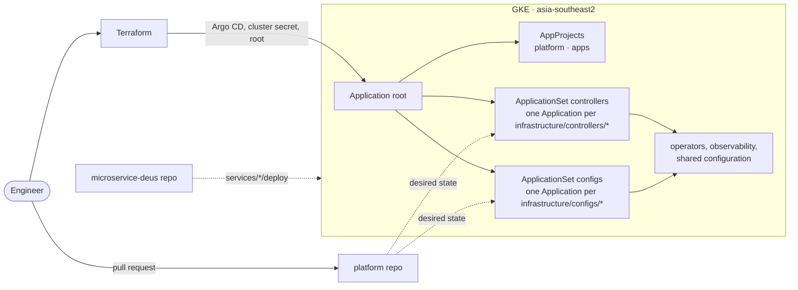
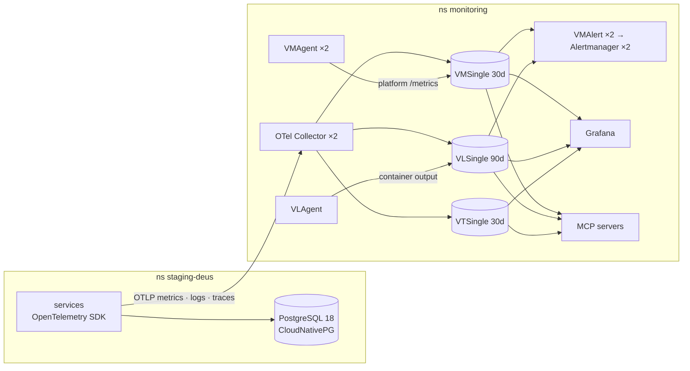

# k8s-victoria-observability

Platform repository for a GKE cluster: infrastructure with **Terraform**, everything inside the cluster with
**Argo CD** (ApplicationSets), and full-stack observability with **OpenTelemetry**, VictoriaMetrics,
VictoriaLogs, VictoriaTraces and Grafana.

Application workloads live in a separate repository,
[microservice-deus](https://github.com/alice101-dev/microservice-deus): it holds the code and the deploy values
of each service, while this repository owns the Argo CD objects that deploy them (project, destination, sync
policy) and the shared platform they run on.

```text
k8s-victoria-observability/
├── terraform/      # GCP: VPC, Cloud NAT, firewall, GKE, Artifact Registry, Cloud Storage, Secret Manager, Argo CD bootstrap
├── bootstrap/      # root.yaml: the only hand-written Application, applied by Terraform
├── appsets/        # AppProjects platform and apps, ApplicationSets controllers, configs and apps
├── infrastructure/
│   ├── controllers/  # one folder per Helm chart: config.yaml (chart, repo, version, namespace) + values.yaml + values-<env>.yaml
│   └── configs/      # one folder per component: custom resources and monitoring (Kustomize base + <env> overlay)
├── tools/          # dashboard generator
├── ci/             # render and validation scripts used by CI
└── docs/           # observability, runbooks
```

## Delivery



- **Layout**: the official Flux example layout. `infrastructure/controllers` installs operators and their CRDs,
  `infrastructure/configs` holds the custom resources and monitoring that need them, and the applications come from
  their own repository (ApplicationSet `apps`).
- **Root app**: `bootstrap/root.yaml` points at `appsets/`. Terraform renders it with the repository URL and
  revision and applies it once; Git is the only way to change the cluster afterwards.
- **ApplicationSets**: a matrix of a Git files generator and the cluster generator. `controllers` creates one
  Application per `infrastructure/controllers/*/config.yaml` (multi-source: the upstream chart plus `values.yaml` and
  `values-<env>.yaml` from this repository); `configs` creates one per `infrastructure/configs/*/config.yaml` from
  `infrastructure/configs/<name>/<env>`.
- **Components per environment**: the cluster generator only selects clusters labelled `enable_<name>: "true"`,
  where `<name>` is the controller folder, or the `requires` field of a config. Terraform sets these labels from
  `enabled_components` in the environment's `argocd-bootstrap` tfvars, so a component is switched on or off per
  environment in one reviewed list. Removing a name deletes its Application and the resources it manages.
- **Promotion**: each environment follows one Git revision for everything (`gitops_target_revision` in its
  tfvars). Terraform renders it into the root Application, whose Kustomize patches write the same revision into
  both ApplicationSets (Git generator and sources), so the component list, chart versions, values and configs all come
  from that revision. Staging follows `main`; a production environment would follow a release tag such as
  `platform-v1.4.0`, moved forward once the change has run in staging.
- **Environments**: Terraform registers the cluster in Argo CD with the label `env=<env>` and annotations
  `platform/project-id`, `platform/image-registry` and `platform/backup-bucket`. The ApplicationSets read the
  environment from the label and inject the annotations where a value contains the project ID, so no project ID
  is stored in Git. The default environment is `staging`; another one needs its own Terraform environment,
  `values-<env>.yaml` files and `infrastructure/configs/*/<env>` overlays.
- **Drift**: every generated Application syncs automatically with `prune` and `selfHeal`, so a resource that is
  deleted or edited by hand (kubectl, the GKE console) is restored within seconds (self-heal timeout 5s), and a
  resource removed from Git is deleted. Retries switch to the newest commit (`retry.refresh`). Not under this rule:
  Argo CD itself and the root Application, which Terraform installs (`make -C terraform apply WS=argocd-bootstrap`
  restores them), and objects created by operators (kgateway proxies, VictoriaMetrics, CloudNativePG pods), which
  their operators recreate. While an Application is being deleted, Argo CD does not sync it.
- **Ordering**: operators and their custom resources are separate Applications. Every Application syncs with
  `SkipDryRunOnMissingResource` and retries with backoff, so custom resources apply as soon as their CRDs exist.
- **Projects**: `platform` may deploy cluster-scoped resources from this repository and the pinned chart
  repositories. `apps` only deploys namespaced workload kinds from the application repository into `<env>-deus`
  (`staging-deus`). Only the application namespace carries the environment: platform namespaces (`monitoring`,
  `argocd`, `kgateway-system`, ...) are the same in every cluster, and the environment is in the cluster name
  (`staging-observability`), the node pool (`staging-spot-pool`), the `env` label and every signal's
  `deployment.environment.name`.
- **Versions**: every chart, image, dashboard and rule URL is pinned. Renovate opens pull requests for the charts
  in `infrastructure/controllers/*/config.yaml`, Terraform providers and GitHub Actions.

## Runtime



| Signal | Path | Store | Query |
|---|---|---|---|
| Application metrics | OTLP → collector → `/opentelemetry/v1/metrics` | VMSingle | MetricsQL |
| Application logs | OTLP → collector (redaction, severity filter) → `/insert/opentelemetry/v1/logs` | VLSingle | LogsQL |
| Application traces | OTLP → collector (redaction) → `/insert/opentelemetry/v1/traces` | VTSingle | Jaeger API, LogsQL |
| Platform metrics | VMAgent scrapes VMServiceScrape / VMPodScrape targets | VMSingle | MetricsQL |
| Container output | VLAgent on every node | VLSingle | LogsQL |
| Kubernetes events | OpenTelemetry Collector `k8s_events` receiver | VLSingle | LogsQL |
| Alerts | VMAlert evaluates MetricsQL and LogsQL rules | – | – |

Nothing is exposed publicly yet. Application traffic enters through the Gateway `kgateway-public` (kgateway), a ClusterIP
Service for now; Grafana, Argo CD, the MCP servers and the gateway itself are reached with `kubectl port-forward`
through the IAM-gated GKE DNS endpoint. The gateway's spans and access logs go to the collector over OTLP, so a
trace starts at the edge and the access log of every request carries its `trace_id`. Details: [docs/observability.md](docs/observability.md).

## Controllers

| Controller | Namespace | Purpose |
|---|---|---|
| `cert-manager` | cert-manager | Certificates (Barman Cloud plugin mTLS) |
| `external-secrets` | external-secrets | Generated and Secret Manager secrets |
| `cloudnative-pg`, `plugin-barman-cloud` | cnpg-system | PostgreSQL operator, backups and WAL archiving to Cloud Storage |
| `victoria-metrics-operator` | vm-operator | Operator and CRDs |
| `victoria-metrics-k8s-stack` | monitoring | Metrics, logs and traces storage, agents, alerting, exporters, vendor dashboards and rules |
| `grafana` | monitoring | Dashboards and exploration |
| `otel-collector` | monitoring | OTLP gateway for the applications |
| `kgateway-crds`, `kgateway` | kgateway-system | Gateway API implementation (Envoy) for the internal Gateway kgateway-public |
| `k8s-events` | monitoring | Kubernetes events to VictoriaLogs |
| `mailpit` | mailpit | SMTP sink with a web UI for the staging email of the applications (`mailpit-smtp:25`); production uses a real SMTP provider |
| `mcp-victoriametrics`, `mcp-victorialogs`, `mcp-victoriatraces`, `mcp-victoriatraces-logsql`, `mcp-grafana` | monitoring | Read-only MCP servers (plus `mcp-argocd` and `postgres-mcp` from `infrastructure/configs/`) |

Configs: `namespaces`, `gateway-api` (Gateway API standard CRDs), `kgateway` (Gateway `kgateway-public`, telemetry, alerts), `argocd`, `cert-manager`, `external-secrets`, `cloudnative-pg` (cluster `deus-db`,
backups, network policy, alerts), `postgres-mcp`, `grafana`, `victoria-metrics-k8s-stack`, `otel-collector`,
`k8s-events`, `mcp-grafana`, `mcp-argocd` (read-only Argo CD MCP server and its token issuer), `redis` (one Redis
for the deus services: sessions and login rate limits of identity, the chart of accounts cache; enabled with the
apps).

## Getting started

Prerequisites: `gcloud`, Terraform 1.15 (`tfenv`), `kubectl`, `make`.

```bash
cp .env.example .env
gcloud config set project <PROJECT_ID>
gcloud auth application-default login

make -C terraform init
make -C terraform apply-all

gcloud container clusters get-credentials staging-observability \
  --location asia-southeast2-a --project "$(gcloud config get-value project)" --dns-endpoint

kubectl -n argocd get applicationsets,applications
```

`apply-all` creates an empty Artifact Registry, so the application images must be pushed again before the deus
Applications can sync. Until then their `*-migrate` hook Jobs stay in `ImagePullBackOff`. From the
[microservice-deus](https://github.com/alice101-dev/microservice-deus) checkout next to this one:

```bash
cd ../microservice-deus
make release
git commit -am "release <tag>"
git push
```

`make release` builds and pushes every image tagged with the current commit and writes that tag into the
`values-staging.yaml` files; once they are pushed, Argo CD retries the hooks with the new tag. If an Application still waits on a hook Job with the old tag, end that operation so the
next sync uses the new commit:

```bash
kubectl -n argocd patch application <app> --type merge -p '{"status":{"operationState":{"phase":"Terminating"}}}'
```

In `staging`, `apply-all` and `teardown` run without a confirmation prompt; pass `AUTO_APPROVE=0` to review each
plan first. Other environments always ask.

Set `PROJECT_ID` in `.env`. The repository URL is taken from `git remote origin` unless `GITOPS_REPO_URL` is set;
for a private fork export `TF_VAR_gitops_repo_password=<read-only token>`.

```bash
kubectl -n monitoring port-forward svc/grafana 3000:80
kubectl -n monitoring get secret grafana-admin -o jsonpath='{.data.admin-password}' | base64 -d; echo
kubectl -n argocd port-forward svc/argocd-server 8080:80
kubectl -n argocd get secret argocd-initial-admin-secret -o jsonpath='{.data.password}' | base64 -d; echo
kubectl -n mailpit port-forward svc/mailpit-http 8025:80
```

## Adding a component

- **Helm chart**: create `infrastructure/controllers/<name>/config.yaml` (`chart`, `repoURL`, `version`, `namespace`, optional
  `ignoreDifferences`), `values.yaml` and `values-staging.yaml` if the environment differs; add the chart
  repository to the `platform` AppProject.
- **Custom resources or monitoring**: create `infrastructure/configs/<name>/config.yaml` (`requires`, `namespace`, optional
  `ignoreDifferences`), `infrastructure/configs/<name>/base/kustomization.yaml` and `infrastructure/configs/<name>/staging/kustomization.yaml`.
- Add the name to `enabled_components` and apply the `argocd-bootstrap` workspace **before** merging, so the label
  exists when the ApplicationSet discovers the folder.

## Exposing a service

Applications publish routes from their own repository: an `HTTPRoute` in `staging-deus` with
`parentRefs: [{name: kgateway-public, namespace: kgateway-system}]`. The Gateway only accepts routes from namespaces labelled
`platform/gateway: kgateway-public` (set in `infrastructure/configs/namespaces`), and the `apps` AppProject allows `HTTPRoute`.

```bash
kubectl -n kgateway-system port-forward svc/kgateway-public 8080:80
curl http://localhost:8080/<path>
```

## Teardown

```bash
make -C terraform teardown
```

It deletes the root Application and the ApplicationSets without cascading, then the generated Applications
layer by layer (apps, configs, then controllers in reverse dependency order), waits until every PVC is gone so no
persistent disk keeps billing, and destroys the Terraform workspaces. `services` and `secret-manager` are kept.

## Staging defaults vs. production

| Staging | Production |
|---|---|
| One VMSingle, VLSingle and VTSingle (no query HA) | Bigger disks first; for HA two independent copies or cluster mode |
| Small disks (30Gi, 20Gi, 20Gi) | Size for the retention in `values-<env>.yaml` and expand online |
| All nodes Spot, zonal cluster | On-demand pool for stateful workloads, regional cluster |
| DEBUG logs kept by the collector | Base values drop records below INFO |
| No trace sampling | Head sampling in the SDKs or tail sampling in the collector |
| Alertmanager `blackhole` receiver | Slack or PagerDuty receiver with credentials from Secret Manager |
| PostgreSQL primary + 1 synchronous standby, 7-day point-in-time recovery | `instances: 3` across zones, backups in a separate project |
| Single Grafana replica with SQLite | External PostgreSQL for Grafana and 2+ replicas |

## Secrets and configuration

- No secrets or project IDs are committed. `PROJECT_ID` lives in the git-ignored `.env`; values that contain it
  are computed by Terraform and stored on the Argo CD cluster secret.
- Terraform state is local per workspace and git-ignored. `make check-project` refuses to run when the active
  `gcloud` project differs from `PROJECT_ID`.

## Dashboards and CI

The platform dashboards (Cluster — Events, Platform — GitOps & Secrets, Platform — MCP servers, Platform — Grafana, Platform — Redis,
Observability — Pipeline health, Gateway — kgateway-public)
and the application dashboards (folder Deus: Overview, SLO Overview, Service, Logs, Traces) are generated by
`tools/dashboards/generate.py`; the CloudNativePG dashboard is the upstream one with scripted fixes
(`tools/dashboards/vendor_cloudnative_pg.py`), and so is the Argo CD dashboard (`tools/dashboards/vendor_argocd.py`). Both write into `infrastructure/configs/grafana/base/dashboards`. The same
generator writes the deus SLO recording rules and alerts (`infrastructure/configs/victoria-metrics-k8s-stack/base/deus.yaml`)
from the objectives in `tools/dashboards/generator/deus.py`, so the SLO dashboard describes exactly the rules. Edit the
generator, never the JSON or that YAML. These dashboards carry the tag `custom`; every other dashboard in Grafana comes
with the victoria-metrics-k8s-stack chart (tag `vm-k8s-stack`).

`.github/workflows/ci.yaml`:

| Job | Checks |
|---|---|
| Dashboards | Committed dashboards and deus rules equal the generator output; datasources, variables, links and panel ids are valid |
| Argo CD applications | Generates the Applications from the ApplicationSets like the controller does, renders each one with the Helm and Kustomize versions Argo CD bundles, validates built-in objects with kubeconform and custom resources (Argo CD objects included) against their CRDs |
| Terraform | `fmt -check` and `validate` of every workspace |

Locally: `python3 tools/dashboards/generate.py`, `python3 ci/validate_dashboards.py` and, with helm, kustomize,
kubeconform and `pip install -r ci/requirements.txt`, `python3 ci/render_manifests.py`.

## License

[MIT](LICENSE)
