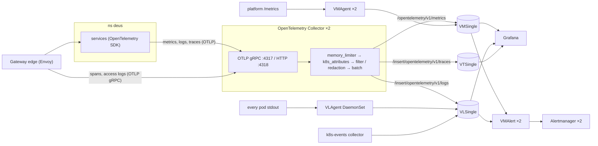

# Observability stack

VictoriaMetrics, VictoriaLogs, VictoriaTraces, Grafana and an OpenTelemetry Collector gateway, deployed by
Argo CD from `addons/` (Helm charts) and `configs/` (Kustomize). Nothing is installed by hand.

| Addon | Chart | Contents |
|---|---|---|
| `victoria-metrics-operator` | vm/victoria-metrics-operator | Operator and CRDs (VMSingle, VLSingle, VTSingle, VMAgent, VMRule, VMServiceScrape, ...) |
| `victoria-metrics-k8s-stack` | vm/victoria-metrics-k8s-stack | VMSingle, VLSingle + VLAgent, VTSingle, VMAgent ×2, VMAlert ×2, Alertmanager ×2, kube-state-metrics, node-exporter, vendor dashboards and rules |
| `grafana` | grafana-community/grafana | Grafana 13 with the VictoriaMetrics and VictoriaLogs datasource plugins |
| `otel-collector` | opentelemetry-collector | OTLP gateway for every application signal |
| `kgateway` | kgateway (OCI) | Edge Gateway; its Envoy proxies send spans and access logs over OTLP |
| `k8s-events` | opentelemetry-collector | Kubernetes events → VictoriaLogs |
| `mcp-*` | VictoriaMetrics and Grafana MCP charts | Read-only MCP servers for AI assistants |

| Config | Contents |
|---|---|
| `configs/grafana` | Admin secret, datasources, the platform dashboards (generated by `tools/dashboards`) |
| `configs/victoria-metrics-k8s-stack` | Pipeline alerts (`observability-pipeline` VMRule) |
| `configs/otel-collector` | Collector scrape and alerts |
| `configs/k8s-events` | Event alerts, collector scrape, restarter CronJob |
| `configs/mcp-grafana`, `configs/mcp-argocd`, `configs/postgres-mcp` | MCP credentials, the Argo CD and PostgreSQL MCP servers |
| `configs/argocd`, `configs/external-secrets`, `configs/cert-manager`, `configs/cloudnative-pg` | Scrapes and alerts of each platform component |

## Data flow



Applications use OpenTelemetry for all three signals, so every log record carries the `trace_id` and `span_id`
of the request and the same resource attributes as its metrics and spans. Platform components keep their native
paths: VMAgent scrapes their `/metrics`, VLAgent tails container output (it also catches whatever an application
prints before its SDK starts, such as a crash).

### OpenTelemetry Collector gateway

| Processor | Signals | What it does |
|---|---|---|
| `memory_limiter` | all | Refuses data at 80% of the memory limit, so the collector pushes back instead of being OOM-killed |
| `k8s_attributes` | all | Adds namespace, pod, deployment, node and the `service.*` attributes from the sender's pod (looked up by connection IP) |
| `resource/metrics` | metrics | Drops attributes that change on every rollout or are per process (`k8s.pod.uid`, replicaset name, `service.instance.id`, `process.*`, `host.*`, `telemetry.sdk.*`, ...): VictoriaMetrics turns resource attributes into labels |
| `filter/severity` | logs | Drops records below INFO in the base values (production); `values-staging.yaml` keeps DEBUG and drops TRACE only |
| `redaction` | logs, traces | Masks attribute values whose key looks like a credential (`password`, `token`, `authorization`, `cookie`, `api_key`, ...) and values that look like bearer tokens or card numbers |
| `transform/redact-body` | logs | Masks `Bearer <token>` and `password=...`-style pairs inside string log bodies |
| `batch` | all | Batches up to 8192 items or 2s |

Exporters send OTLP/HTTP with gzip. VictoriaLogs gets `VL-Stream-Fields: service.name,k8s.namespace.name`, so one
log stream exists per service instead of one per pod. VMSingle runs with `-opentelemetry.usePrometheusNaming`:
`http.server.request.duration` (seconds) is stored as `http_server_request_duration_seconds_bucket/_sum/_count`
and attributes become labels such as `service_name` and `http_response_status_code`.

The collector is checked locally with the image it runs:

```bash
helm template otel-collector opentelemetry-collector --repo https://open-telemetry.github.io/opentelemetry-helm-charts \
  --version "$(sed -n 's/^version: //p' addons/otel-collector/config.yaml)" \
  -f addons/otel-collector/values.yaml -f addons/otel-collector/values-staging.yaml \
  | yq 'select(.kind == "ConfigMap") | .data.relay' > /tmp/relay.yaml
docker run --rm -v /tmp/relay.yaml:/relay.yaml:ro -e MY_POD_IP=127.0.0.1 \
  otel/opentelemetry-collector-contrib:<appVersion> validate --config=/relay.yaml
```

### Gateway telemetry

The ListenerPolicy `edge-telemetry` (`configs/kgateway/base/telemetry.yaml`) configures the Envoy proxies of the
Gateway `edge`:

- **Traces**: an `ingress` server span per request (service `edge-gateway`) and, with `spawnUpstreamSpan`, a client span
  per upstream call; the W3C `traceparent` header is forwarded, so the services' spans join the same trace.
- **Access logs**: one OpenTelemetry log record per request (`logName: edge-access`) with the method, path, status,
  Envoy response flags, route, upstream cluster and host, duration, client address, user agent and request ID as
  attributes. Envoy sets the record's `trace_id` and `span_id`, so logs and traces correlate.
- **Metrics**: Envoy statistics on `:9091/metrics` (rewritten to `/stats/prometheus?usedonly`), scraped by the
  VMPodScrape `kgateway-proxy`; controller metrics by the VMServiceScrape `kgateway`.

The proxies reach the collector in `monitoring` through a ReferenceGrant there. The controller only discovers the
namespaces labelled `platform/gateway: edge`, `kgateway-system` and `monitoring`, which keeps Envoy's configuration and
its metric series small. Rates in the gateway alerts and dashboard divide by the sum of `*_rq_xx` over every status
class rather than `*_rq_total`: a status class that appears for the first time is counted from zero, and dividing two
counters of the same family keeps the ratio between 0 and 1.

### Endpoints (namespace `monitoring`)

| Purpose | URL |
|---|---|
| OTLP gRPC for applications | `otel-collector.monitoring.svc:4317` |
| OTLP HTTP for applications | `http://otel-collector.monitoring.svc:4318` |
| PromQL / MetricsQL | `http://vmsingle-vmks.monitoring.svc:8428/prometheus` |
| LogsQL | `http://vlsingle-vmks.monitoring.svc:9428/select/logsql/query` |
| LogsQL on spans | `http://vtsingle-vmks.monitoring.svc:10428/select/logsql/query` |
| Jaeger API | `http://vtsingle-vmks.monitoring.svc:10428/select/jaeger` |

## Topology and sizing

| Signal | Components | Replicas | Storage (staging) | Retention (staging) |
|---|---|---|---|---|
| Metrics | VMSingle | 1 | 30Gi pd-balanced | 30d |
| Scraping | VMAgent StatefulSet, deduplicated at 30s on VMSingle | 2 | 2 × 10Gi persistent queue (8GiB cap) | until delivered |
| Alerting | VMAlert → Alertmanager (gossip cluster) | 2 / 2 | 2 × 10Gi (silences, notification log) | – |
| Logs | VLSingle + VLAgent DaemonSet | 1 (+1 agent per node) | 20Gi | 90d, oldest days dropped at 80% disk |
| Traces | VTSingle | 1 | 20Gi | 30d, oldest days dropped at 80% disk |
| OTLP | OpenTelemetry Collector | 2 | in-memory sending queues | until delivered |
| UI | Grafana | 1 | 10Gi runtime state | – |

Sizes and retention live in `addons/victoria-metrics-k8s-stack/values-staging.yaml`; a new environment gets its
own `values-<env>.yaml`. Each signal runs as one single-node process: far below its limits here (single-node
VictoriaMetrics serves 100k+ active series; VictoriaLogs compresses logs 10-50x). The trade-off is no query or
ingestion HA: during a storage restart or Spot preemption (about 2 minutes) dashboards and alert evaluation pause,
while VMAgent, VLAgent and the collector buffer and resend.

Disks grow online (raise `storage`; `standard-rwo` allows expansion). VictoriaMetrics deletes per monthly
partition, so its disk holds retention + 1 month. VictoriaLogs and VictoriaTraces keep daily partitions and run
with `-retention.maxDiskUsagePercent=80`: they drop their oldest days once the filesystem is 80% full (the docs ask
for at least 20% free, because usage is checked periodically and a full disk turns them read-only). The effective
retention is then shorter than configured; `VictoriaLogsRetentionCutByDiskCap` and
`VictoriaTracesRetentionCutByDiskCap` say so.

## Configuration decisions

| Where | Setting | Why |
|---|---|---|
| `victoria-metrics-operator` | Installed separately from the stack | CRD and operator upgrades and removal order are controlled independently |
| `victoria-metrics-operator` | Admission webhook disabled | Its certificate comes from Helm `genCA` at render time; Argo CD re-renders without `lookup`, so CA bundle and certificate drift apart and every CR is rejected. Validation stays with the CRD schema and the reconcile status. Enable it with cert-manager (`admissionWebhooks.certManager.enabled`) |
| `victoria-metrics-operator` | `image.tag` one patch ahead of the chart | Bug fixes for VMSingle, VLSingle and VTSingle; drop the override with the next chart |
| `victoria-metrics-operator` | `disable_prometheus_converter` | No prometheus-operator CRDs in this cluster |
| `victoria-metrics-k8s-stack` | `nameOverride/fullnameOverride: vmks` | Short resource names under the 63-character limit: `vmsingle-vmks`, `vlsingle-vmks`, `vtsingle-vmks` |
| `victoria-metrics-k8s-stack` | Dashboard and rule URLs pinned to release tags | The chart defaults point at `master` |
| `victoria-metrics-k8s-stack` | `DiskRunsOutOfSpace` of the `vlogs` and `vtraces` groups disabled | It fires forever with `maxDiskUsagePercent=80`; replaced by the RetentionCutByDiskCap alerts |
| `victoria-metrics-k8s-stack` | Internal vmauth ×2 | It routes vmalert's LogsQL queries to VLSingle, so it is on the rule evaluation path |
| VMSingle | `search.maxConcurrentRequests: 8`, `search.maxMemoryPerQuery: 128MB` | One wide query (dashboard, AI assistant) cannot OOM the process |
| VMSingle | `storage.maxHourlySeries: 500k`, `storage.maxDailySeries: 1.5M` | Cardinality explosions are dropped and logged |
| VMSingle | `storage.minFreeDiskSpaceBytes: 2GB` | Read-only before the disk is completely full |
| VMSingle | `dedup.minScrapeInterval: 30s` | Deduplicates the two VMAgent replicas; must equal the scrape interval |
| VMAgent | `statefulMode` with a 10Gi queue, `maxDiskUsagePerURL: 8GiB` | Buffered samples survive rescheduling while VMSingle is down (about 1.5 days) |
| Alertmanager | Storage on PVCs | Silences and the notification log survive both replicas restarting |
| VLAgent | Tolerates every taint | No node's logs are missed |
| VTSingle | `servicegraph.enableTask` | Derives service-to-service calls for the Jaeger dependencies API |
| kubelet | `/metrics/resource` scrape disabled | It repeats the container CPU and memory series of `/metrics/cadvisor`, so every sum counted twice |
| kubelet | Relabelling keeps only the node pool | The default label map copies every GKE node label (46-51 labels), above VictoriaMetrics' 40-label limit, and whole series were dropped |
| kube-state-metrics | Node label allowlist (zone, node pool, provisioning model, machine type) | Used by the events dashboard and node alerts |
| Control plane | controller-manager, scheduler, etcd, kube-proxy and CoreDNS scrapes disabled; kube-dns scraped | GKE manages the control plane, Dataplane V2 has no kube-proxy, GKE runs kube-dns |
| Grafana | Separate addon; datasources in `configs/grafana` | Datasources, dashboards and correlation links are reviewed as code |
| Grafana | PVC with `Recreate` strategy, no chown init container | Keeps service accounts, tokens and annotations across restarts; fsGroup 472 owns the volume |
| Grafana | Memory request 768Mi | The VictoriaLogs plugin runs in the Grafana container; dashboards refreshing every minute exceeded a lower limit |
| `k8s-events` | One replica | The `k8s_events` receiver keeps no shared state; a second replica would store every event twice |
| `k8s-events` | CronJob restart every 20 minutes | Upstream bug: the receiver's watch stalls silently after 30-60 minutes ([opentelemetry-collector-contrib#51982](https://github.com/open-telemetry/opentelemetry-collector-contrib/issues/51982)). `KubeEventsCollectorStalled` alerts if it still happens. Remove once a release has the fix |
| `k8s-events` | Tolerant probes | Restarts lose the events of that moment, exactly the node events this collector exists for |
| `mcp-victoriametrics` | `MCP_LOG_LEVEL=warn`, memory request 768Mi | At info it logs every result (8 MB lines); the embedded docs index takes about 500 MB |
| MCP servers | Startup probes with 5 minutes of tolerance | Loading the embedded documentation takes more than 40s |

## Grafana

Datasources (`configs/grafana/base/datasources.yaml`): **VictoriaMetrics** (default, Prometheus type),
**VictoriaMetrics (DS)**, **VictoriaLogs**, **VictoriaTraces** (Jaeger), **VictoriaTraces (LogsQL)** (the
VictoriaLogs plugin on VTSingle, for analytics over spans) and **Alertmanager**.

- Log → trace: the `trace_id` field opens the trace.
- Trace → logs: `trace_id:="<id>"` on VictoriaLogs.
- Trace → metrics: request rate, 5xx rate and p95 of the span's service (`service.name` → `service_name`).

Dashboards come from ConfigMaps labelled `grafana_dashboard: "1"` in any namespace; the `grafana_folder`
annotation picks the folder. The vendor dashboards of the stack and the generated platform dashboards are in
**Platform**.

```bash
kubectl -n monitoring port-forward svc/grafana 3000:80
kubectl -n monitoring get secret grafana-admin -o jsonpath='{.data.admin-password}' | base64 -d; echo
```

## AI assistants (MCP)

Read-only [Model Context Protocol](https://modelcontextprotocol.io) servers let AI assistants query the stack.

| Service | Backend | Main tools |
|---|---|---|
| `monitoring/vm-mcp` | VMSingle | `query`, `query_range`, `metrics`, `labels`, `series`, `rules`, `alerts`, `tsdb_status`, `explain_query` |
| `monitoring/vl-mcp` | VLSingle | `query`, `hits`, `stats_query_range`, `facets`, `field_values`, `streams` |
| `monitoring/vt-mcp` | VTSingle | `services`, `traces`, `trace`, `dependencies` |
| `monitoring/vt-logsql-mcp` | VTSingle (LogsQL) | `stats_query`, `stats_query_range`, `query`, `field_names`, `field_values` over spans |
| `monitoring/grafana-mcp` | Grafana API | dashboards, datasources, `run_panel_query`, PromQL and LogsQL queries, alert rules, deeplinks |
| `monitoring/mcp-argocd` ([mcp-for-argocd](https://github.com/argoproj-labs/mcp-for-argocd)) | Argo CD API | `list_applications`, `get_application`, `get_application_resource_tree`, `get_application_managed_resources`, `get_application_workload_logs`, `get_application_events`, `get_resource_events`, `get_resources`, `list_clusters`, `get_appproject` |
| `deus/postgres-mcp` | PostgreSQL (`deus-db`) | sessions, locks, long transactions, statement and table statistics, one read-only statement at a time |

All run behind ClusterIP services and are reached with port-forwarding. The Victoria servers have no
authentication; `grafana-mcp` and `mcp-argocd` require a bearer token; `postgres-mcp` logs in as `mcp_readonly`
(only `pg_monitor`: no table data, cannot cancel sessions) with read-only, 10s-limited sessions.

```bash
kubectl -n monitoring port-forward svc/vm-mcp 8090:8080 &
kubectl -n monitoring port-forward svc/vl-mcp 8091:8080 &
kubectl -n monitoring port-forward svc/vt-mcp 8092:8080 &
kubectl -n monitoring port-forward svc/grafana-mcp 8093:8000 &
kubectl -n deus port-forward svc/postgres-mcp 8094:5000 &
kubectl -n monitoring port-forward svc/vt-logsql-mcp 8095:8080 &
kubectl -n monitoring port-forward svc/mcp-argocd 8096:3000 &
kubectl -n monitoring get secret mcp-grafana-server-token -o jsonpath='{.data.token}' | base64 -d; echo
kubectl -n monitoring get secret mcp-argocd-server-token -o jsonpath='{.data.token}' | base64 -d; echo
```

```json
{
  "mcpServers": {
    "victoriametrics": { "type": "http", "url": "http://localhost:8090/mcp" },
    "victorialogs": { "type": "http", "url": "http://localhost:8091/mcp" },
    "victoriatraces": { "type": "http", "url": "http://localhost:8092/mcp" },
    "victoriatraces-logsql": { "type": "http", "url": "http://localhost:8095/mcp" },
    "postgres": { "type": "http", "url": "http://localhost:8094/mcp" },
    "grafana": { "type": "http", "url": "http://localhost:8093/mcp", "headers": { "Authorization": "Bearer <token>" } },
    "argocd": { "type": "http", "url": "http://localhost:8096/mcp", "headers": { "Authorization": "Bearer <token>" } }
  }
}
```

`grafana-mcp` keeps its own credentials in `configs/mcp-grafana`: a Viewer service account token rotated every
24 hours (7-day TTL) and the caller token, both generated by External Secrets. DNS-rebinding protection only
accepts `Host: localhost:8093`.

`mcp-argocd` runs with `MCP_READ_ONLY=true` (create, update, delete, sync and resource actions are not offered) and
talks to Argo CD as the local account `mcp-argocd`, which Terraform creates with the `apiKey` capability only and
binds to `role:readonly`. Its API token is issued by the `mcp-argocd-token-issuer` Job, a Sync hook of
`config-mcp-argocd`: it keeps a token that still works, otherwise it logs in with the initial admin password,
creates a non-expiring token for `mcp-argocd`, stores it in the Secret `mcp-argocd-token` and restarts the
server. A rebuilt cluster therefore gets a fresh token on its first sync; after an Argo CD reinstall on the same
cluster, sync `config-mcp-argocd` again. The caller token (`mcp-argocd-server-token`) is generated once by
External Secrets, the server only accepts `Host: localhost`, and a NetworkPolicy admits no pod. Revoke a token
with `argocd account delete-token --account mcp-argocd <id>`.

Query results are sent to the model provider of the AI client.

## Upgrading

Renovate opens one pull request per chart in `addons/*/config.yaml`. Before merging a
`victoria-metrics-k8s-stack` upgrade, also bump `global.versions`, the image tags and the pinned dashboard and rule
URLs in its values, and read the [changelog](https://docs.victoriametrics.com/helm/victoria-metrics-k8s-stack/changelog/).
CRDs are rendered as templates and upgraded with server-side apply.
